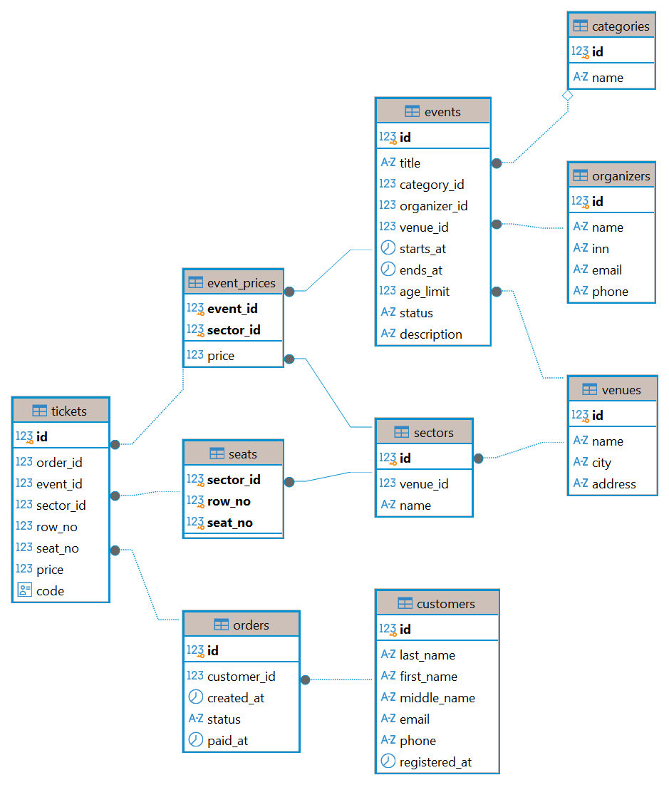

# Лабораторная работа 1. Проектирование и реализация реляционной БД

**Вариант 12 — сервис продажи билетов на мероприятия.** Номер в списке 27: (27 − 1) mod 15 + 1 = 12.

## Что требуется

1. Выделить сущности, атрибуты и связи предметной области.
2. Спроектировать реляционную модель в 3НФ.
3. Построить ER-диаграмму: таблицы, основные атрибуты, PK/FK, связи.
4. Реализовать БД в PostgreSQL и заполнить тестовыми данными.
5. Показать работу ограничений целостности — минимум 5 некорректных `INSERT`/`UPDATE`, которые база отклоняет.

Требования к схеме: не меньше 5 таблиц, 2 `UNIQUE`, 3 `CHECK`, одно составное ограничение,
`NOT NULL` на обязательных полях; типы данных и правила `ON DELETE` — по смыслу предметной области.

Вторая часть (сдаётся отдельно): преподаватель выдаёт изменение требований, структура меняется
через `ALTER TABLE` без пересоздания БД и с сохранением данных.

## Предметная область

Организаторы проводят мероприятия на площадках. Площадка делится на секторы, в секторе — места
(ряд + номер). На каждое мероприятие задаются цены по секторам. Покупатель оформляет заказ из
билетов на конкретные места; одно место на одно мероприятие можно продать только один раз.

## Файлы

| Файл | Содержание |
|---|---|
| [schema.sql](schema.sql) | структура: 10 таблиц, ключи, `UNIQUE`, `CHECK`, правила `ON DELETE` |
| [data.sql](data.sql) | тестовые данные (места генерируются через `generate_series`) |
| [constraints_test.sql](constraints_test.sql) | 9 операций, которые база отклоняет (по одной на каждый вид ограничения), и демонстрация `ON DELETE` |
| `ER-diagram.png` | ER-диаграмма, экспорт из DBeaver |
| [migration.sql](migration.sql) | изменение структуры: статус «перенесено» и рост цены ближе к дате |

## ER-диаграмма



## Запуск

Из корня репозитория, после `docker compose up -d`:

```bash
docker compose exec pg psql -U postgres -d labs -f /labs/lab1/schema.sql
docker compose exec pg psql -U postgres -d labs -f /labs/lab1/data.sql
docker compose exec pg psql -U postgres -d labs -f /labs/lab1/constraints_test.sql
docker compose exec pg psql -U postgres -d labs -f /labs/lab1/migration.sql
```

- `schema.sql` пересоздаёт таблицы, `data.sql` очищает их и сбрасывает счётчики id — оба можно запускать повторно.
- `constraints_test.sql` **должен** выдать 9 ошибок `ERROR` — это отклонённые операции. Данные он не меняет.
